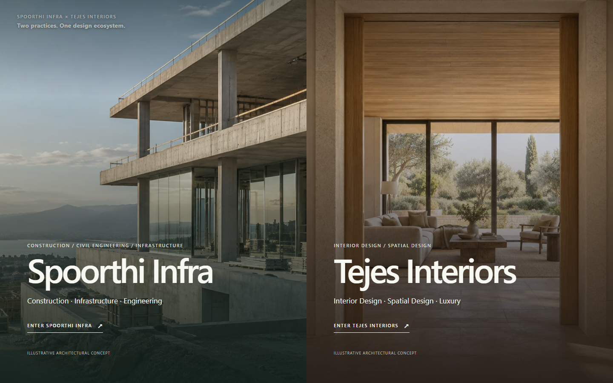
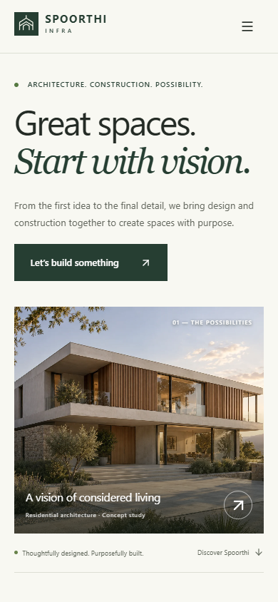
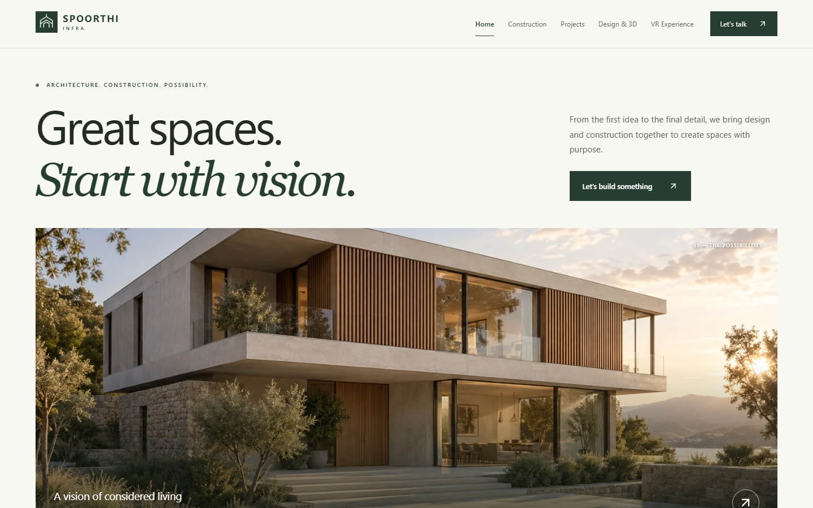
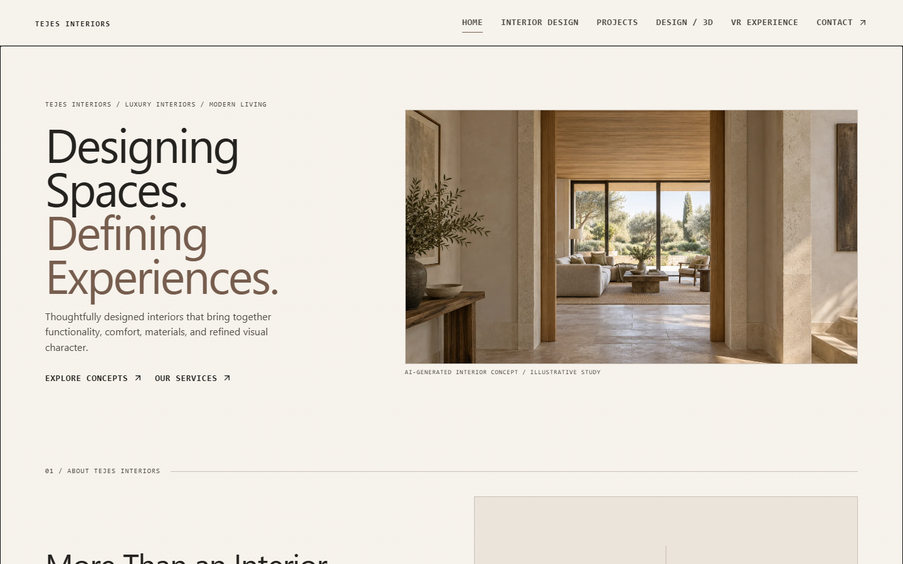
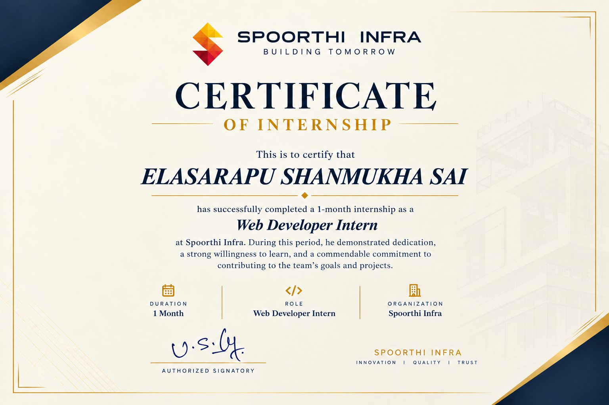
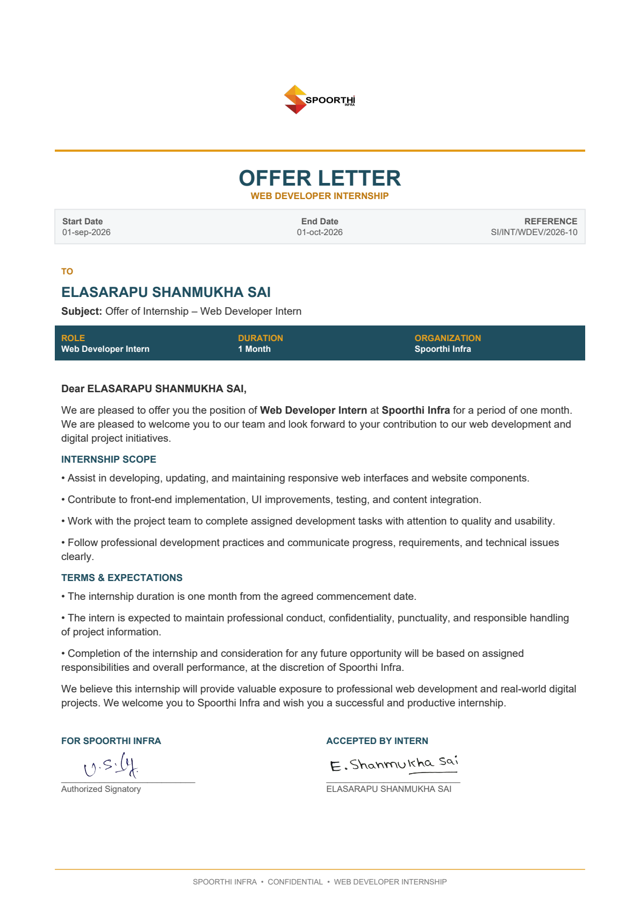

# Spoorthi Infra Website Development Internship Report

**Student:** ELASARAPU SHANMUKHA SAI  
**Roll Number:** 25EU05R0025  
**Programme:** Second Year B.Tech Computer Science and Engineering  
**University:** Malla Reddy (MR) Deemed to be University  
**Organization:** Spoorthi Infra  
**Role:** Web Developer Intern  
**Period:** 1 September 2026 to 1 October 2026

## Declaration and Approval

### Student Declaration

I, ELASARAPU SHANMUKHA SAI (Roll Number 25EU05R0025), submit this report on “Spoorthi Infra Website Development” as a record of the frontend internship project. The description of the application, its features, and its limitations is based on the project source and the supplied internship documents. I have not presented illustrative concept images as completed client work or claimed unimplemented backend features.

Student signature: ___________________________       Date: ____________________

### Approval Sheet

This report is submitted to the Department of Computer Science and Engineering, Malla Reddy (MR) Deemed to be University, for academic review. Approval remains subject to the department’s verification and signatures.

Faculty guide: ___________________________       Signature: ____________________

Head of Department: _____________________       Signature: ____________________

Date and institutional seal: ______________________________________________

## Acknowledgement

I thank Spoorthi Infra for the opportunity to work as a Web Developer Intern. The project helped me connect classroom knowledge with the practical work of arranging content, designing pages, developing React components, and checking how a website behaves on different screen sizes. I also thank the Department of Computer Science and Engineering at Malla Reddy (MR) Deemed to be University for encouraging practical learning.

## Abstract

This report presents the frontend development of a website for Spoorthi Infra and Tejes Interiors during the internship period from 1 September to 1 October 2026. A gateway at the root route lets visitors choose a brand. Each brand then has its own pages, navigation, imagery, and visual style. The Spoorthi Infra experience presents construction, architecture, project concepts, design visualization, spatial exploration, and contact. Tejes Interiors presents interior design, concept studies, and contact pages.

The application uses React, Vite, React Router, JavaScript, CSS, and Lucide React. Reusable components organize common interface elements while separate data and style files support each brand. The contact interfaces prepare enquiries for email, copying, or downloading; they do not send data to a backend. The spatial pages use browser-based image interaction rather than a verified headset VR system. The result is a responsive frontend that gives both brands a clear digital presentation.

## Contents

- Chapter 1  Introduction and Internship Overview — 5
- Chapter 2  Website Design and Architecture — 6
- Chapter 3  Implementation and Main Features — 7
- Chapter 4  Testing, Learning and Conclusion — 8
- Appendix I  Internship Certificate — 9
- Appendix II  Internship Offer Letter — 10

## Chapter 1  Introduction and Internship Overview

### 1.1 Internship Details

Elasarapu Shanmukha Sai, a second-year B.Tech student in Computer Science and Engineering, undertook a one-month Web Developer internship at Spoorthi Infra from 1 September 2026 to 1 October 2026. The offer letter identifies responsive web interfaces, frontend implementation, UI improvements, testing, and content integration as the internship scope. The supplied certificate records successful completion of the internship.

### 1.2 Project Background and Need

The website brings together Spoorthi Infra and Tejes Interiors in one application while retaining distinct experiences. Visitors interested in construction, architecture, or infrastructure can enter the Spoorthi Infra site; visitors interested in interiors can enter the Tejes Interiors site. The gateway makes that choice clear at the start. The pages then present services and concept studies in an organized way and offer an enquiry path.

### 1.3 Objectives and Scope

The project aims to provide a professional digital presence, readable navigation, responsive pages, and a consistent way to present the design journey. The frontend scope covers the gateway, brand home pages, services and projects, 2D and 3D design content, spatial experience sections, and contact interfaces. It does not include a backend server, database, authentication, payment processing, or server-side form submission.

### 1.4 Responsibilities

The internship brief identifies UI planning, page layout, component development, routing, responsive styling, version control, and browser inspection as relevant responsibilities. The source repository supports the presence of these frontend elements. It does not establish which individual completed every change, so this report describes the project work without assigning unsupported personal credit.

## Chapter 2  Website Design and Architecture

### 2.1 Dual-Brand Structure

The application begins at / with a two-panel brand gateway. React Router defines nested route groups for /spoorthi and /tejes. Each group has a separate layout and page set, while shared components provide containers, buttons, form fields, and navigation behavior. A loading-state component is present in the source, but a timed loading screen before every visit is not established.

### 2.2 Responsive Interface

The desktop layout uses broad imagery, clear headings, and navigation across the top. At narrower widths, the page layout and navigation adapt to fit the available space. CSS stylesheets, including responsive rules, control spacing, typography, and media presentation. The screenshots below come from the running local project.

### 2.3 Design Journey

The content links early 2D planning to 3D visualization, final presentation, and spatial exploration. A plan communicates layout; 3D material helps a visitor understand form and finishes; final output presents the developed direction; and the spatial section lets the visitor inspect an illustrative scene in the browser. These pages explain a design process and do not imply that a complete production VR system has been built.

## Chapter 3  Implementation and Main Features

### 3.1 Technology and Code Organization

React builds the interface from reusable components. Vite runs the development server and creates the production bundle. React Router connects URLs to pages. JavaScript handles interaction, Lucide React supplies icons, and CSS styles the layouts. The examined package does not list Tailwind CSS, so this report describes the implemented styling as CSS-based. Project content and route definitions are separated into data and route files.

### 3.2 Pages and Interactions

Spoorthi Infra includes a home page, civil construction, concept projects and detail pages, 3D design, a spatial image explorer, and contact. Tejes Interiors includes a home page, interior design, projects, 3D design, spatial exploration, and contact. The project pages clearly label illustrative concept studies instead of presenting them as completed client projects. Buttons and links move visitors between these pages and relevant sections.

### 3.3 Contact and Spatial Experience

The contact interfaces validate details and prepare a text brief. A visitor can open an email draft, copy the brief, or download it, depending on the page. No configured endpoint receives the form on a server. The spatial sections provide image selection, zoom, and viewpoint exploration in the browser. They are visual demonstrations and not verified real-time VR tours.

## Chapter 4  Testing Learning and Conclusion

### 4.1 Verification

The local project was built with the Vite production build command and checked with the repository’s lint command. Both completed successfully during report preparation. The browser preview was opened at desktop and narrow viewport sizes to capture the genuine screenshots in this report. A full historical test log for the internship was not supplied; further review should cover every route, keyboard navigation, forms, and multiple devices.

### 4.2 Learning Outcomes

The project demonstrates component-based development, route organization, responsive styling, content separation, and browser-based interaction. It also shows the importance of describing the boundary of an implementation accurately: a useful frontend enquiry interface can prepare an email without claiming a backend submission, and a spatial image explorer can communicate a design without claiming headset VR.

### 4.3 Limitations and Future Scope

There is no implemented backend, database, server-side enquiry processing, authentication, or payment flow. The displayed project studies are illustrative concepts. Future work could connect a consent-aware enquiry service, add verified project material, improve accessibility through broader audits, measure and optimize performance, and develop richer spatial assets when approved.

### 4.4 Conclusion

The project provides a clear frontend presentation for Spoorthi Infra and Tejes Interiors. Its gateway and brand-specific routes help visitors move from a broad choice to relevant services and project ideas. Reusable React structure supports consistency while distinct layouts preserve each brand’s identity. The present result is a functioning website interface within a frontend-only scope.

### References

[1] Spoorthi Infra, Web Developer Internship Offer Letter, reference SI/INT/WDEV/2026-10, supplied PDF.

[2] Spoorthi Infra, Internship Certificate for Elasarapu Shanmukha Sai, supplied image.

[3] Spoorthi Infra website project files: package.json, README.md, src/routes, src/pages, src/components, and src/styles; inspected 9 October 2026.

## Appendix I  Internship Certificate

The supplied certificate confirms successful completion of a one-month Web Developer internship at Spoorthi Infra.

## Appendix II  Internship Offer Letter

The supplied offer letter records the Web Developer Intern role and the dates 1 September to 1 October 2026.

